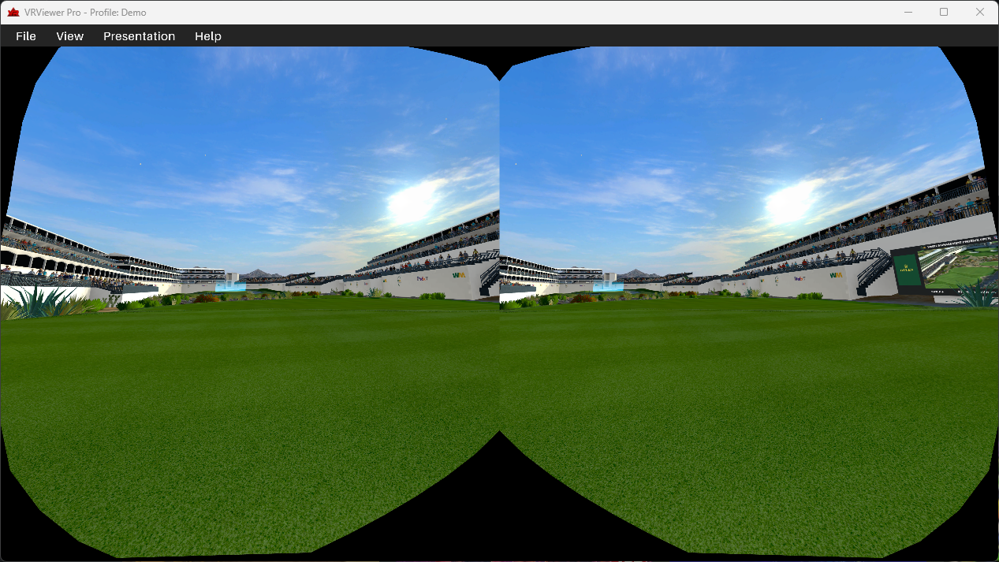
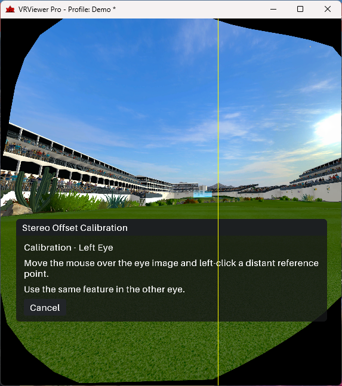
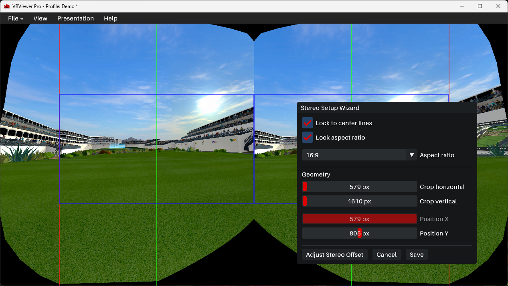
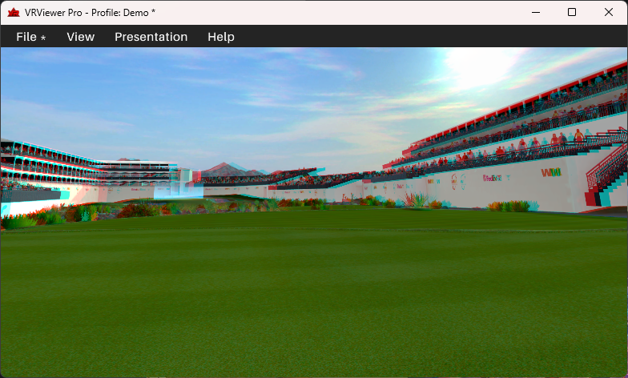
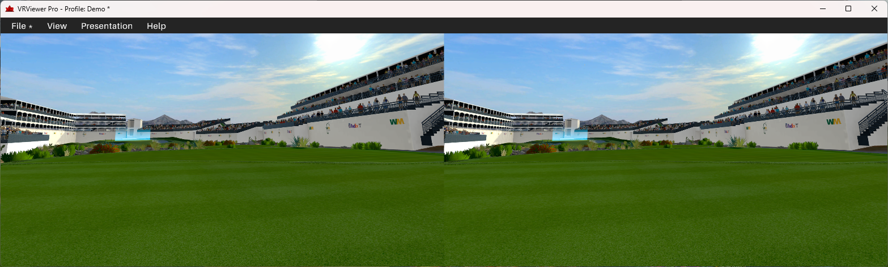
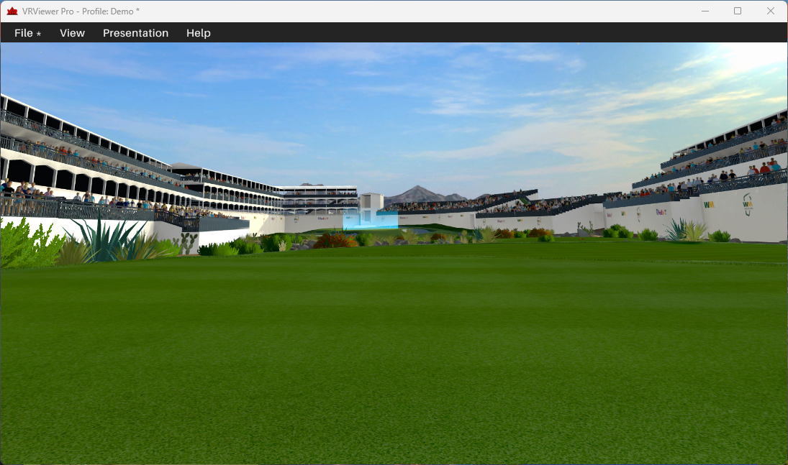

# VRViewer

VRViewer is a Windows desktop application for viewing and mirroring VR content through supported capture sources and runtimes.

For downloads, installation instructions, and product information, visit the official website:

**[LTM Technologies — VRViewer](https://www.ltmtechnologies.com/vrviewer.html)**

## Features

- View VR content through supported capture sources.
- Select from available source integrations.
- Access a dedicated desktop viewer for VR content.
- Check for application updates.

See the official website for the latest feature list and system requirements.

## Screenshots

See VRViewer in action:

| Source Textures | Stereo Calibration |
|---|---|
|  |  |

| Presentation Editor | Anaglyph Presentation |
|---|---|
|  |  |

| Side-by-Side Presentation | Single Eye Presentations |
|---|---|
|  |  |

## System Requirements

| Component | Requirement |
|---|---|
| Operating System | Windows 10 or Windows 11 (64-bit) |
| Processor | 2-core CPU or better |
| Memory | 4 GB RAM |
| Graphics | GPU supporting the graphics APIs required by the selected source |
| Supported Sources | SteamVR and OpenXR runtimes |
| OpenXR Graphics APIs | Direct3D 11 (D3D11), Direct3D 12 (D3D12) |
| Storage | 5 GB of free disk space |
| Internet | Required for online license validation, updates, and downloads, where applicable |

### VR Headset Compatibility

VRViewer supports stereoscopic headsets using a conventional two-view layout (left and right eye). Quad-view rendering configurations are not supported.

### Anti-Cheat Compatibility

- **Easy Anti-Cheat (EAC):** Currently supported.
- **BattlEye:** Not supported when using the OpenXR capture source.

Anti-cheat compatibility may vary by game, capture source, and anti-cheat configuration. Support for one anti-cheat system does not guarantee compatibility with every game using it.

*These are baseline recommendations, not guaranteed minimums. Windows 10 was tested in a virtual machine with 2 vCPUs and 2 GB RAM for installation and the UI/Test source only. OpenXR and SteamVR capture requirements have not yet been validated under these resource constraints. Hardware and runtime compatibility may vary.*

## Download

Download the latest stable release from [GitHub Releases](https://github.com/leethemaxuser/VRViewer-Public/releases).

Each release includes version-specific release notes and any published installer files.

For licensed or additional features, visit the [official VRViewer website](https://www.ltmtechnologies.com/vrviewer.html).

## Installation

1. Download the installer from the appropriate release or product download page.
2. Run the installer and follow the installation instructions.
3. Ensure your OpenXR runtime and VR software are configured correctly.
4. Launch VRViewer and select an available capture source.

Refer to the official documentation for detailed setup instructions and compatibility information.

## Support

- **Bug reports:** [Open an issue](https://github.com/leethemaxuser/VRViewer-Public/issues/new/choose)
- **Feature requests:** [Open an issue](https://github.com/leethemaxuser/VRViewer-Public/issues/new/choose)
- **Documentation:** [VRViewer Wiki](https://github.com/leethemaxuser/VRViewer-Public/wiki)
- **Website:** [ltmtechnologies.com](https://www.ltmtechnologies.com/)

When reporting a problem, include your VRViewer version, Windows version, OpenXR runtime, selected source, and steps to reproduce the issue. VRViewer does not currently generate application logs. If the OpenXR layer is involved, you may be able to provide its logs after removing sensitive information.

## Releases

See [all releases](https://github.com/leethemaxuser/VRViewer-Public/releases) for version history, changes, and downloads.

## License

VRViewer's application licensing terms are provided through the official website and applicable product documentation. Unless a separate license is explicitly provided for files in this repository, no additional rights to redistribute or modify the application should be assumed.
